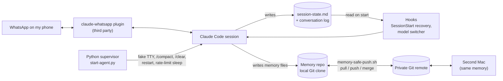
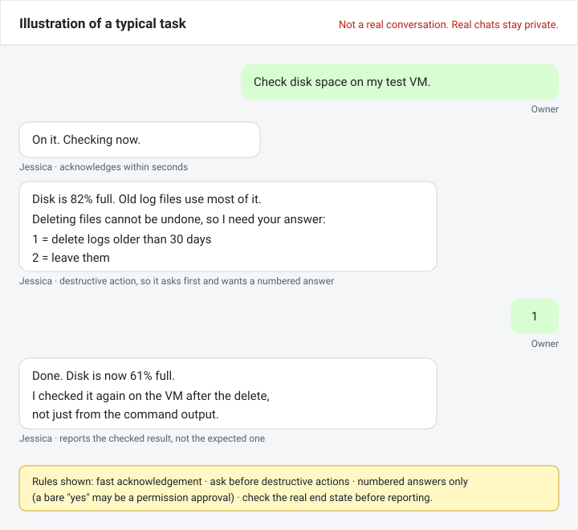

# Jessica — a personal AI agent on WhatsApp

By Iman Hamka ([github.com/imanhamka](https://github.com/imanhamka)). Personal project.

> **Scope note.** This repo shows the agent runtime only. It holds no employer code, data or conversations.

Jessica is a Claude Code session that I run 24/7 on my own Mac. I send it tasks from WhatsApp. It does IT work for me: reading logs, editing code, running tests, writing docs. It replies on WhatsApp when done.

I built it because many requests reach me away from my desk. I wanted to hand off a task from my phone and get a checked result back, not a guess.

One user: me. Jessica answers only to its owner.

## What I built vs. what I used

| Part | Who | Notes |
|---|---|---|
| WhatsApp message I/O | **Third party** | The [`claude-whatsapp`](https://github.com/crisandrews/claude-whatsapp) Claude Code plugin by Juan Cristobal Andrews (MIT). I used v1.20.2 when I wrote this setup. I did not write the WhatsApp bridge. |
| Claude Code, Claude models | **Third party** | Anthropic. |
| PTY supervisor (`src/start-agent.py`) | Me | Keeps the session alive. Details below. |
| Session recovery hook (not published) | Me | Restores state after a restart. Not published because it handles conversation data. |
| Git memory sync (`src/hooks/memory-safe-push.sh`) | Me | Shares memory between two Macs. |
| Model switcher (`src/hooks/model-switcher.sh`) | Me | Primary/fallback model state. |
| Guard rails, identity file, memory design, agent-team prompts | Me | See [`docs/identity.md`](docs/identity.md). |

## Architecture



Machines: an iMac runs Jessica full time. A MacBook runs normal Claude Code sessions. Both read and write the same memory repo.

## What the supervisor does

`src/start-agent.py` is about 670 lines of standard-library Python. It runs Claude Code inside a pseudo-terminal, because Claude Code expects a real TTY.

- **Fake TTY.** Opens a PTY with a fixed window size and spawns `claude` on it.
- **Startup dialog.** Detects the confirm bar and sends Enter. Forces Enter after 60 s if the dialog text never matches.
- **Context limit.** Parses the `NN% context used` status line. Sends `/compact` at 75%. After two compacts at 95%, it restarts fresh.
- **Periodic refresh.** Every 30 minutes it asks the agent to flush state to disk, waits for a sentinel file, then sends `/clear`. The process and the WhatsApp connection stay up.
- **Flush grace.** If the agent never touches the sentinel, it clears after 7 minutes anyway.
- **Busy sentinel.** A fresh `.busy` file or a `pending:` line in `session-state.md` defers the refresh. A 2-hour hard cap stops a stale marker from blocking it forever.
- **Rate limit.** On a real limit dialog it parses the reset time, kills the session, sleeps until reset, and exits so `launchd` restarts it.
- **Usage warning.** At 80% session usage it asks the agent to send me one WhatsApp notice.
- **Connection errors.** Three connection errors in a row trigger a restart. `SIGTERM` escalates to `SIGKILL` after 10 s.
- **Session swap.** An owner command can switch Jessica into another project session and back.

Model fallback lives in `src/hooks/model-switcher.sh`.

## Daily use



- I send a task on WhatsApp: check a log, fix a bug, write a test, draft a document.
- Jessica replies within seconds, does the work, and sends back the result.

See [`docs/example-task.md`](docs/example-task.md) for the step-by-step flow.

## Safety model today

Safety today is mostly policy, not enforcement. Be clear about this before you reuse anything here.

- The session skips Claude Code permission prompts. The approval rules below live in instructions, and a model can ignore instructions.
- The hard boundary is the bridge allowlist: it only passes direct messages from my number. Strangers never reach the model.
- Planned next: an allowlist of commands enforced in a hook, read-only accounts for server checks, and approval checked in code, not in the prompt.

## How I check the AI's output

I do not trust a report because the model wrote it. These rules live in the identity file and project instructions:

- **Ask before risky actions.** Destructive commands (`rm -rf`, force push, drop table) need my approval. So does anything other people see: messages to anyone but me, GitHub PRs, production deploys.
- **Owner check outside the text.** Jessica treats a message as mine only when the bridge marks the sender as the owner. That mark sits outside the message text. A name or phone number typed in a message does not count.
- **Two attempts, then report.** After two failed fixes it stops. It sends me the exact error, what it tried, and what it needs.
- **CI gates on its own code.** Code it writes goes branch → PR → CI (lint, build, tests, dependency and SAST scans) → my approval → merge. Red CI blocks merge.
- **Run it, not only test it.** Definition of done includes running the change in the real app, not only unit tests.
- **Ground truth before "done".** A report is checked against the live file, service, or database. See the second lesson below.

## Known limits

- **Single user, single host.** One owner. Jessica runs on one iMac. If that Mac sleeps or loses network, Jessica is down.
- **Screen scraping.** The supervisor reads Claude Code's terminal output with regexes. A UI text change in a Claude Code update can break context or rate-limit detection.
- **Third-party bridge.** WhatsApp I/O depends on the `claude-whatsapp` plugin and an unofficial WhatsApp Web session. A logout or protocol change stops all messaging.
- **Permissions are skipped.** The session runs with `--dangerously-skip-permissions`. Safety comes from the written rules and from my approval, not from a sandbox. A rule the model ignores is not enforced by code.
- **Timezone is hardcoded.** Rate-limit reset parsing assumes UTC+8.
- **Model switcher on macOS.** `check` uses GNU `date -d`. On macOS that call fails, so the elapsed time is always large and it reverts to primary at once. Unfixed in this copy.
- **Memory conflicts.** A real merge conflict keeps both versions as separate files. I clean those up by hand.
- **No automated tests** for the supervisor itself. I tested it by running it and reading the logs.

## A real mistake and the fix

**What happened.** Jessica had asked me an open question on WhatsApp. At the same time, the plugin relayed a sub-agent's permission prompt to the same chat ("Reply yes <code> / no <code>"). I sent a bare "yes" to approve that prompt. Jessica read my "yes" as the answer to its own open question. It started work and launched an agent. I stopped it and asked it to explain first.

**Why it happened.** The permission relay and the agent's own question share one chat. A bare "yes" carries no reference, so it had two meanings. The agent picked the one that fit its own open question.

**Fix.** A standing rule now says:

- A bare "yes" after a permission relay is a permission approval. It never starts new work.
- An open question needs an answer that names the item or a number.
- When unsure, Jessica asks me a numbered question instead of guessing.

**Second lesson: a sub-agent's report is not evidence.** Jessica ran a small fix through a sub-agent. The run stalled and was resumed. Two sub-agent reports then came back and told different stories about what the code looked like before the change. Neither report proved the end state. Jessica read the file directly and checked the service status. The fix was in place, but only the direct check showed that.

A similar case: a feature was logged as done after a partial browser click-through. A real automated test later showed an authorization check had rejected every user since the feature was built.

**Fix.** Before reporting "done", Jessica checks ground truth directly. Examples: `grep` the live file, check the service status, assert the database row. A success message on screen does not count.

## Repo layout

```
src/start-agent.py               PTY supervisor
src/hooks/memory-safe-push.sh    concurrent-safe memory push
src/hooks/model-switcher.sh      model fallback state
docs/identity.md                 identity file concept + excerpt
docs/example-task.md             how a typical task runs
```

Code in `src/` is a sanitized copy of what runs. I replaced the owner ID, machine paths, and workplace names with environment variables or generic text. Prompt texts sent to the model live in a private `prompts/` directory and are loaded by name.

Environment variables used: `WA_OWNER_JID`, `WA_CHAT_ID`, `WA_AGENT_DIR`, `WA_STATE_DIR`, `WA_SESSION_MAX_AGE`, `WA_SESSION_HARD_MAX`, `WA_FLUSH_GRACE`, `CLAUDE_BIN`, `CLAUDE_MEMORY_REPO`.

## License

MIT. See [LICENSE](LICENSE).
